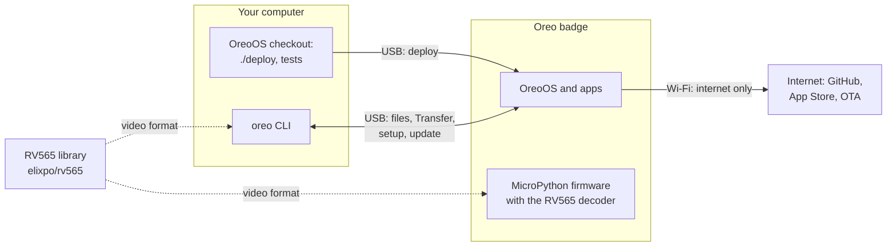
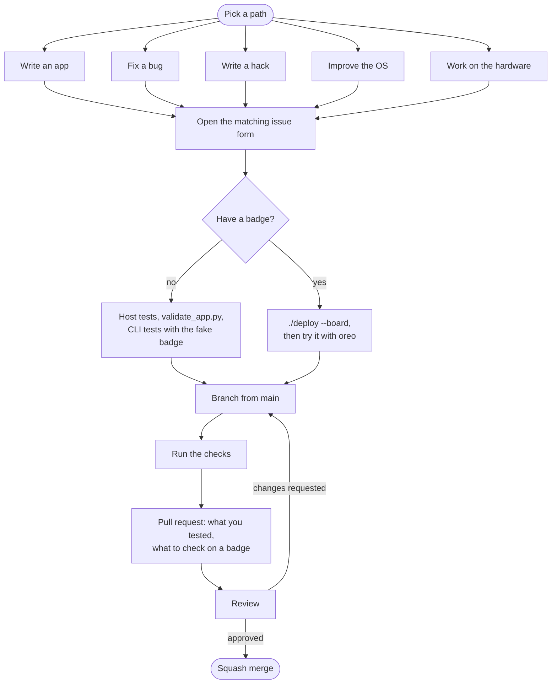

# Contributing to Oreo

Thank you for your interest in Oreo! Oreo is an open conference badge:
the hardware, **OreoOS** (the MicroPython operating system that runs on
it), its apps, and **oreo-cli** (the `oreo` command that connects a
computer to the badge). You can contribute **without owning a badge**:
most of the code is tested on an ordinary computer.

Please read the [Code of Conduct](CODE_OF_CONDUCT.md) first; it applies
everywhere in the project.

## The project at a glance

| Part | Where | Language |
|---|---|---|
| OreoOS: launcher, home screen, App Store, OTA, network service, helpers | `oreoOS/` | MicroPython 1.28 |
| Hardware drivers | `oreoWare/` | MicroPython |
| Built-in apps (19) and App Store apps (10) | `apps/`, `apps_market/` | MicroPython |
| oreo-cli, the `oreo` command (full-screen view, files, Transfer, apps, Wi-Fi, setup, updates) | `cli/` | Python 3.9+ |
| Host tools: deploy, release, asset conversion, app checks | `tools/` | Python |
| Tests that need no hardware | `tests/`, `cli/tests/` | Python, standard library |
| Firmware build for the `OREO_BADGE` board | `firmware/` | C / CMake |
| Website, including the CLI docs | `oreo.elixpo/` | Next.js |

The badge plays video with **RV565**, a separate library and file format
([elixpo/rv565](https://github.com/elixpo/rv565)) with its own contributing
guide.

How the pieces fit, and the rules we build by, are in
[AGENTS.md](AGENTS.md): Wi-Fi is only for the internet, a computer reaches
the badge over USB through the `oreo` CLI, Bluetooth comes last, and the OS
and the CLI must agree on a handful of contracts.

### How the pieces connect



A computer reaches the badge only over USB, through the `oreo` CLI or a
deploy from a checkout. The badge uses Wi-Fi only for the internet: the App
Store, OreoOS updates, GitHub data and the weather. Videos are RV565 files:
the CLI encodes them and the firmware decodes them.

## How a contribution goes



Pick one of five paths and open its issue form. The form asks for what a
reviewer needs, so we can agree on the approach before you spend time on
it:

| Path | Issue form | Start from |
|---|---|---|
| Write an app | [App proposal](https://github.com/elixpo/oreo/issues/new?template=app_proposal.yml) | [docs/APPS.md](docs/APPS.md), `oreo new` |
| Fix a bug | [Bug report](https://github.com/elixpo/oreo/issues/new?template=bug_report.yml) | `oreo info`, `oreo doctor`, [good first issues](https://github.com/elixpo/oreo/issues?q=is%3Aopen+label%3A%22good+first+issue%22) |
| Write a hack | [Hack proposal](https://github.com/elixpo/oreo/issues/new?template=hack_proposal.yml) | [docs/hacks/](docs/hacks/README.md) |
| Improve the OS | [OS improvement](https://github.com/elixpo/oreo/issues/new?template=os_improvement.yml) | [AGENTS.md](AGENTS.md), [docs/OS_ROADMAP.md](docs/OS_ROADMAP.md) |
| Work on the hardware | [Hardware](https://github.com/elixpo/oreo/issues/new?template=hardware.yml) | [Work on the hardware](#work-on-the-hardware), [`circuit/elixpo/`](circuit/elixpo/) |

Anything else (the website, tooling) goes in the
[other idea form](https://github.com/elixpo/oreo/issues/new?template=feature_request.yml).
A typo or a one-line fix can go straight to a pull request.

## Start without a badge

Everything here runs on Linux, macOS or Windows (WSL) with Python 3.9 or
newer:

```bash
git clone https://github.com/elixpo/oreo && cd oreo
python3 -m unittest discover -s tests            # about 400 OS and app tests
python3 tools/validate_app.py                     # checks every app
python3 -m venv .venv && . .venv/bin/activate
pip install ./cli                                 # the oreo CLI
python -m unittest discover -s cli/tests          # about 300 CLI tests (fake badge)
oreo --help
```

Good first contributions without hardware:

- An issue labelled
  [good first issue](https://github.com/elixpo/oreo/issues?q=is%3Aopen+label%3A%22good+first+issue%22).
- A new App Store app: start with `oreo new my_app` or copy
  [`app_templates/`](app_templates/), and follow [docs/APPS.md](docs/APPS.md).
  The tests and `validate_app.py` check most of what the badge would.
- Tests for code that has none, and documentation fixes.
- Finding a module that imports hardware directly instead of going through
  the OS layer ([#67](https://github.com/elixpo/oreo/issues/67)).

## With a badge

Build one from [docs/HARDWARE.md](docs/HARDWARE.md) and
[docs/BREADBOARD_BOM.md](docs/BREADBOARD_BOM.md) (an ESP32-S3-DevKitC-1
N16R8 on a breadboard works), then:

```bash
cp .env.example .env.local      # your Wi-Fi and profile; git-ignored
./deploy --full                 # first time: the prebuilt firmware, then OreoOS
./deploy --board                # later: OreoOS only, changed files
oreo doctor && oreo             # the CLI's checks, then its full-screen view
```

Building the firmware from source (`./build-firmware`) needs ESP-IDF; see
[`firmware/`](firmware/).

[docs/USB.md](docs/USB.md) explains the USB ports and the REPL;
[docs/CLI.md](docs/CLI.md) every `oreo` command.

## Work on the hardware

The badge is certified open source hardware
([OSHWA IN000107](https://certification.oshwa.org/in000107.html)). Its
KiCad 10 design is in [`circuit/elixpo/`](circuit/elixpo/): a schematic
for a bare ESP32-S3R8 board, a sourcing BOM, and a PCB that is not laid
out yet. Open work is labelled
[hardware](https://github.com/elixpo/oreo/issues?q=is%3Aopen+label%3Ahardware);
the ones marked help wanted are ready to pick up. You don't need a badge to
review a schematic or lay out a board, and you need only a breakout board
to write a driver.

How the design is kept:

- **The schematic is generated.** The four sheets and
  `BOM_PRELIMINARY.csv` are written by
  [`generate_badge_schematic.py`](circuit/elixpo/generate_badge_schematic.py).
  Change the script, run `circuit/elixpo/build.sh` (KiCad 10's `kicad-cli`
  on your PATH), and commit what it writes. Edits made in the schematic
  editor are overwritten by the next run, so port them back to the script.
- **The PCB is drawn by hand** in `elixpo.kicad_pcb`, from the generated
  schematic.
- **CI checks both** (`.github/workflows/hardware.yml`): the committed
  schematic must match the generator, ERC must report nothing, and once the
  board has footprints, DRC must pass with schematic parity. The job
  uploads the schematic PDF, the BOM and the reports, so reviewers can read
  a change without KiCad.
- **Pins are shared with the OS.** [`oreoWare/pins.py`](oreoWare/pins.py)
  is the single source of truth for the GPIOs the OS uses. A pull request
  that moves a pin changes the schematic, `pins.py`, the drivers that use
  it and [docs/HARDWARE.md](docs/HARDWARE.md) together, like the OS and CLI
  contracts in [AGENTS.md](AGENTS.md).
- **New hardware needs a driver first.** A part that replaces one the OS
  already drives (the MPU-6050, the buttons) is merged together with, or
  after, a driver in `oreoWare/` with host tests. Drivers sit behind the
  interfaces in `oreoOS/api.py`, so apps don't change.

In a hardware pull request, say what you changed and why: part numbers,
datasheet links, the calculation behind each value, and which pins it uses
or frees. Say what was checked (ERC, DRC, a calculation, a breadboard or
breakout test) and what can only be checked on an assembled board.

Hardware design files are licensed under CERN-OHL-P-2.0; see
[`circuit/elixpo/README.md`](circuit/elixpo/README.md) for the design
decisions and what has to be settled before layout.

## Workflow

1. For anything larger than a small fix, open the issue form for your path
   (above) or comment on an existing issue first, so we can agree on the
   approach before you spend time on it.
2. Fork the repository and branch from `main`
   (`git checkout -b fix/short-description`).
3. Make the change, with tests. Keep pull requests small and about one
   thing.
4. Run the checks below.
5. Open a pull request: what changed and why, what you tested, and, for
   badge code, what still has to be checked on a badge. Link the issue.
6. A maintainer reviews. We squash-merge once it's approved.

## Checks before a pull request

- [ ] `python3 -m unittest discover -s tests` passes, and
      `python -m unittest discover -s cli/tests` for changes under `cli/`.
- [ ] `python3 tools/validate_app.py` reports no errors.
- [ ] New logic has a test. Tests use only the standard library and load
      badge modules by path (see `tests/test_app_platform.py`).
- [ ] Badge code keeps to MicroPython 1.28: no `abc`, `typing`,
      `dataclasses`, `pathlib`, and nothing large at module level.
      Compile-check with `mpy-cross` v1.28 if you have it.
- [ ] Nothing in an app's `update()` or `draw()` blocks; network calls run
      on a worker.
- [ ] A change to a contract between the OS and the CLI (see
      [AGENTS.md](AGENTS.md)) updates both sides, their tests and the docs.
- [ ] Docs updated, and `cli/CHANGELOG.md` (`## [Unreleased]`) for changes
      to the CLI.
- [ ] No tokens, passwords or personal data in the code.

### App checklist

- [ ] `python3 tools/validate_app.py <your app folder>` reports no errors.
- [ ] The app folder has a `README.md`: one sentence on what it does, the
      controls, and a screenshot or photo.
- [ ] It has an icon (`python3 tools/app_icon.py <folder>`).
- [ ] A selects, B goes back, HOME is the OS's. C opens the notification
      panel unless the app sets `CAPTURES_C = True` (then a double-tap of C
      opens it).
- [ ] Movement uses `dt`; `draw()` skips unchanged frames.
- [ ] Saves go through `oreoOS.state`; the owner's details come from
      `oreoOS.profile`.
- [ ] App Store apps: `python3 tools/build_store_index.py` run, the
      `apps_market/index.json` entry filled in, and `version` bumped when
      an existing app changes.

## Releases

- **OreoOS:** maintainers run `python tools/release.py`. It tags
  `stable/vX.Y.Z` (or `beta/...`) and publishes the GitHub release that
  badges update from over the air, in the repository named by `OTA_REPO`
  in `oreoOS/ota.py` (or `--repo owner/name`); `--dry-run` shows it.
  Forks publish to themselves this way
  ([docs/hacks/ota-fork.md](docs/hacks/ota-fork.md)).
- **oreo-cli:** a `cli-v<version>` tag runs
  `.github/workflows/cli-release.yml`, which tests, builds, attests and
  publishes the release with its installers.

## Google Summer of Code 2027

Elixpo is applying to be a mentoring organisation for Google Summer of Code
2027; Google has not announced the 2027 programme yet. Oreo's proposed idea
is the [Oreo badge desktop simulator](https://gsoc.elixpo.com/ideas/oreo-badge-simulator/)
(175 hours, intermediate): running OreoOS apps on an ordinary computer, with a
headless mode for automated tests.

If you're interested:

1. Read the idea page and [gsoc.elixpo.com](https://gsoc.elixpo.com).
2. Do the warm-up tasks on the idea page. None of them need a badge.
3. Contribute a small pull request here, as described above. How you work
   with review matters as much as the code.
4. Questions about the programme go to **gsoc@elixpo.com**.

_Google Summer of Code is a programme of Google LLC. Elixpo is applying as a
mentoring organisation; it has not been accepted._

## Licensing of contributions

The licensing, engineering and process rules in
[`PREAMBLE.md`](PREAMBLE.md) apply to every contribution.

By submitting a contribution you agree that it is licensed inbound under
the Elixpo standard (**MIT** for code, **CERN-OHL-P-2.0** for the
hardware design files under `circuit/`, **CC-BY-4.0** for assets) and that
you have the right to submit it. The
[Developer Certificate of Origin](https://developercertificate.org) applies
to every commit; sign off with `git commit -s`. We don't require a CLA. See
[LICENSE](LICENSE) and [NOTICE](LICENSES/NOTICE), including the reserved
Elixpo and Oreo names and marks.

## Questions

Open a thread in [Discussions](https://github.com/orgs/elixpo/discussions),
or email **hello@elixpo.com**. Response times are in [SUPPORT.md](SUPPORT.md).
We're glad you're here.
