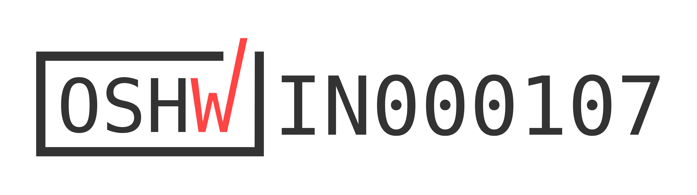

# OreoOS: preamble

  
  
  
  

OreoOS, the operating system of the Oreo Badge, is provided under:

    SPDX-License-Identifier: MIT

being under the terms of the MIT License, according with:

    LICENSE
    LICENSES/preferred/MIT

The badge hardware is provided under:

    SPDX-License-Identifier: CERN-OHL-P-2.0

according with:

    LICENSES/preferred/CERN-OHL-P-2.0

and is certified open source hardware by the Open Source Hardware
Association, UID IN000107:

> **A** badge with just one wallpaper, and it's your face it shows; 
> **N**o Wi-Fi, still connected: that's how being with you goes. 
> **W**hen frames change, I send the diff, but you I send in full; 
> **E**ach keyframe of my life is you; the rest is fairly dull. 
> **S**o scroll back up and read the start of every line I've spun: 
> **H**idden in the margin is the girl who made this run, 
> **A**nd yes, it spells your name, Miss Co-author. You're the one.

<a href="https://certification.oshwa.org/in000107.html">
  <picture>
    <source media="(prefers-color-scheme: dark)" srcset="oreo.elixpo/public/oshw_mark_card.png">
    
  </picture>
</a>

Brand and visual assets are provided under:

    SPDX-License-Identifier: CC-BY-4.0

according with:

    LICENSES/preferred/CC-BY-4.0

In addition, the firmware image incorporates MicroPython (MIT) and Espressif
ESP-IDF (Apache-2.0), whose licences downstream distributors of compiled
firmware must retain; see:

    LICENSES/preferred/Apache-2.0
    LICENSES/notices/notice-board

The Elixpo and Oreo names, the Oreo mascot, the chest E-badge and the
elixpo.com domains are not licensed by any of the above; see:

    TRADEMARKS.md
    LICENSES/NOTICE

All contributions to OreoOS are subject to this preamble, and to the rules
below.

---

## 1. Licensing rules

1.1. **The licence follows the path.** Unless a file states otherwise:

| Path | Licence |
| --- | --- |
| Source code, scripts, configuration and documentation, everywhere | `MIT` |
| Hardware design files under `circuit/` (schematics, PCB, symbols, BOMs, generated outputs) | `CERN-OHL-P-2.0` |
| Brand and visual art under `assets/` and every app's `assets/` (mascot, sprites, icons, banners, splash art) | `CC-BY-4.0` |

1.2. **New files may say so on their first line.** A new source file may
start with an SPDX identifier matching the table, as a comment in the file's
own syntax:

    # SPDX-License-Identifier: MIT

It must not name a licence other than the one its path gives it.

1.3. **Third-party code keeps its licence.** Code copied or vendored from
elsewhere keeps its original licence and copyright lines, is listed in
`LICENSES/notices/notice-board`, and needs maintainer approval before it is
merged. No code under a licence incompatible with MIT is merged into the MIT
tree.

1.4. **Inbound equals outbound.** By submitting a contribution you agree that
it is licensed under the licence its path gives it, and that you have the
right to submit it. There is no CLA.

1.5. **Every commit is signed off.** The
[Developer Certificate of Origin](https://developercertificate.org) applies to
every commit; sign off with `git commit -s`.

1.6. **Licence texts live in `LICENSES/`.** Its layout mirrors the Linux
kernel's: `preferred/` holds the licence texts in use, `exceptions/` and
`notices/` the rest. A licence is added there before anything may use it.

## 2. Engineering rules

These decide most design questions before they come up. A change that breaks
one is not merged.

2.1. **The badge works on its own.** Nothing on the badge waits on the
network or blocks the screen. Slow work runs on a worker, and the user sees a
loading state (`oreoOS.busy`, `oreoOS.cache.Refresh`).

2.2. **Wi-Fi is for the internet only:** the App Store, OTA updates, GitHub
data, weather and time. Nothing listens on the local network.

2.3. **A computer reaches the badge over USB,** through the `oreo` CLI. Files
go through the Transfer app, guarded by a code shown on the badge; setup is a
CLI command.

2.4. **Bluetooth comes last,** together with the mobile app.

2.5. **The OS and the CLI ship together and must agree.** A change on one side
of a contract (profile keys, built-in apps, app checks, app template,
Transfer protocol, the "connected to computer" screen, USB identity
`303a:83ec`) changes the other side, its tests and its docs in the same pull
request. A newer CLI must keep working with the previous OS release.

2.6. **No personal data in the code.** The owner's name, GitHub user and
location come from `oreoOS.profile`, never from the source. No secrets are
committed: `.env` is SOPS-encrypted, personal values live in `.env.local` or
on the badge.

2.7. **Every change is tested without hardware.** Host tests stand in for the
badge. Whatever only a badge can show is written in the pull request as a test
step.

## 3. Rules for apps

3.1. Apps subclass `oreoOS.App` and implement `on_enter`, `update(dt)`,
`draw(d)`, `on_button_press(btn)` and `on_exit`. They never call
`d.present()`: the launcher owns the frame.

3.2. Nothing in `update` or `draw` blocks. Network calls go through
`oreoOS._http`, with a timeout, on a worker.

3.3. A selects, B goes back, HOME belongs to the OS. C opens the notification
panel; an app that uses C sets `CAPTURES_C = True`, and a double tap of C then
opens the panel.

3.4. Apps persist through `oreoOS.state`, read the owner through
`oreoOS.profile`, and prefer the `os` object to importing `oreoWare` or
`machine`.

3.5. Code runs on MicroPython 1.28: no `abc`, `typing`, `dataclasses` or
`pathlib`, and no large module-level buffers on a small heap.

3.6. Every app passes `tools/validate_app.py`.

## 4. Process

4.1. Work happens on a branch and lands through a pull request, squash-merged;
`main` is protected.

4.2. A pull request says what changed, what was tested on the host, and what
still has to be checked on a badge.

4.3. Before a pull request:

    python3 -m unittest discover -s tests
    python3 -m unittest discover -s cli/tests
    python3 tools/validate_app.py

4.4. **Merging is releasing.** A merge to `main` that touches `oreoOS/` or
`oreoWare/` publishes an OTA release on the stable channel, which badges
install over Wi-Fi. Changes that only a badge can check are checked on a badge
before they merge.

4.5. Security issues are reported privately, as
[`docs/SECURITY.md`](docs/SECURITY.md) describes, never in a public issue.
How decisions are made is in [`docs/GOVERNANCE.md`](docs/GOVERNANCE.md); how
contributors behave, in [`CODE_OF_CONDUCT.md`](CODE_OF_CONDUCT.md).

## 5. What OreoOS is

OreoOS is written in MicroPython 1.28 for an ESP32-S3 with 16 MiB of flash and
8 MiB of PSRAM, a 2.0" 320x240 ST7789 screen, eight buttons, an IMU, an
infrared transceiver, Wi-Fi and Bluetooth. It owns the screen, the buttons, the
network, storage and power, and runs applications it loads at runtime. About
39,000 lines of Python make up the OS, its drivers and its apps.

| Layer | Where | What it does |
| --- | --- | --- |
| Firmware | [`firmware/`](firmware/) | MicroPython 1.28 for the `OREO_BADGE` board, with native modules for infrared and RV565 video |
| Drivers | [`oreoWare/`](oreoWare/) | Display, buttons, Wi-Fi, Bluetooth, IMU, infrared, and `os.py`, the object handed to apps |
| OS | [`oreoOS/`](oreoOS/) | Launcher and run loop, home screen, notification panel, App Store, OTA updates, network service, and the helpers apps use |
| Apps | [`apps/`](apps/), [`apps_market/`](apps_market/) | The apps every badge has, and the optional ones the App Store installs |
| Host tools | [`cli/`](cli/), [`tools/`](tools/) | The `oreo` CLI, deploy and release tools, the app validator |

The Gallery plays RV565, a video format made for this badge: frames are stored
in the panel's own pixel format, so the device only inflates and transfers,
and partial deltas send only the rows that changed (arXiv:2610.35935).

Where to go next: [`docs/APPS.md`](docs/APPS.md) to write an app;
[`docs/USB.md`](docs/USB.md), [`docs/CLI.md`](docs/CLI.md) and
[`docs/TRANSFER.md`](docs/TRANSFER.md) to use the badge from a computer;
[`docs/HARDWARE.md`](docs/HARDWARE.md) for the hardware;
[`docs/LEARN.md`](docs/LEARN.md) for a guided tour of the code;
[`AGENTS.md`](AGENTS.md) for the same rules, written for coding agents.

## 6. Dedication

Every system has a reason it was finished. This one is dedicated to A., for
its full runtime: the second author of the video format the Gallery plays,
who read every frame of it before anyone else did. Her name is in the poem
at the top of this preamble, one letter at the start of each line.

